# Threadkeeper

**Find the threads. Build the argument.**

[](../../actions/workflows/ci.yml)

Threadkeeper is a local-first desktop app (Electron + React) with two halves:

- **The Sidecar:** a cat's head that floats on your desktop. Click it for your notes: text, checklists, reminders, research notes, decisions, screenshots, voice and video. Reminders pop up on the cat 5 minutes before a deadline and again when it is overdue.
- **The Research Desk:** turn papers into an evidence-linked argument map. An AI (NVIDIA Nemotron via Nebius Token Factory) extracts claims, findings, methods and limitations **with verbatim quotes**, and proposes how they connect. Nothing joins your argument until you review it.

<p align="center">
  
  &nbsp;&nbsp;
  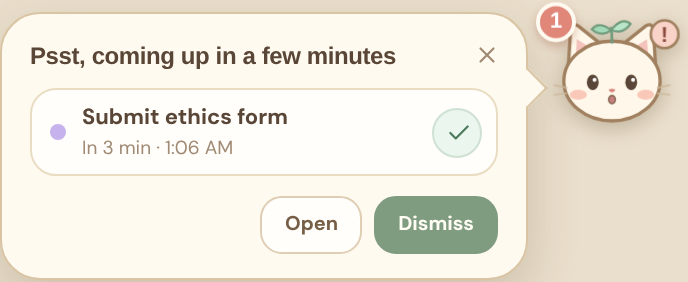
</p>

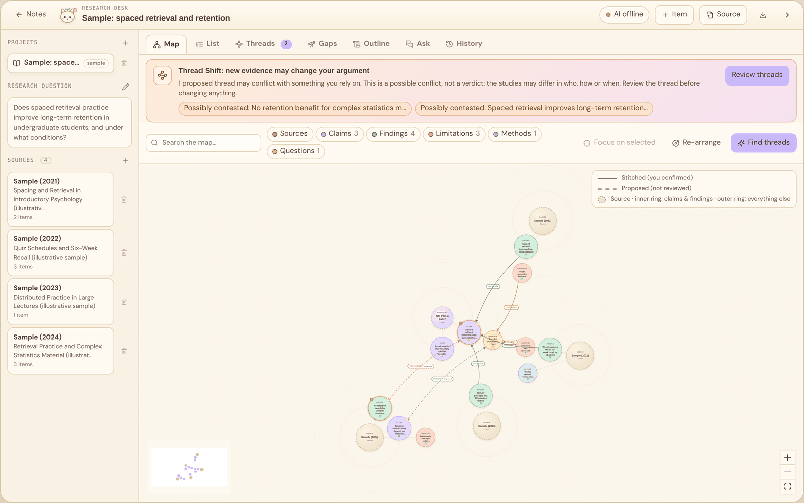

> Screenshots use the built-in **sample project** (four invented papers, marked "illustrative sample") and, for paper search, **mock records** with example DOIs. No real study is represented.

---

## Contents

- [What it does](#what-it-does)
- [Screenshots](#screenshots)
- [How a research project flows](#how-a-research-project-flows)
- [Architecture](#architecture)
- [Run it](#run-it)
- [Tests and CI](#tests-and-ci)
- [Results so far](#results-so-far)
- [Limitations](#limitations)
- [Repository layout](#repository-layout)

## What it does

**Sidecar**

| | |
|---|---|
| Cat-head window | Only the head, no frame or taskbar button. Drag it anywhere (it stays where you drop it); click to open. |
| Notes | One **+** opens a picker: text, task/checklist, research, decision, reminder, screenshot, voice, video. Unlimited notes; delete any note with Undo. |
| Checklists | A checklist is a note type. Tick, edit, delete items (or Backspace on an empty line), **Clear done**. Checklist items have no dates. |
| Reminders | A deadline is a Reminder note. The main process schedules it: cat bubble + desktop notification **5 minutes before**, and again **when overdue**. Never fires twice. |
| AI Inbox | "Remind me to … tomorrow" makes a reminder; without a time it adds a checklist item. Ask what is left or due. |

**Research Desk**

| | |
|---|---|
| Capture | Text-based PDFs, pasted text, **Find papers** (OpenAlex → Crossref, no key; paste a DOI or arXiv link), open-access full text, or a sidecar note. |
| Extract | AI items with verbatim quotes + page. Quotes not found in the source are removed. Items that say more than their quote are labelled **Partly sourced** with the reason. Items reporting someone else's study are marked **Cites other work**. Re-extracting skips what is already on the map. |
| Rings map | Each source sits in the middle of its cluster; claims and findings on an inner ring; methods, limitations, questions and gaps on an outer ring. Threads pull linked circles, and papers, together. |
| Threads | Cross-paper pairs and tension cues first; the model reasons per pair, a second critical reading keeps, fixes or drops each proposal. Relations include **contradicts** and **qualifies**. You **Stitch**, **Edit** (incl. swap direction), **Investigate** or **Dismiss**. |
| Thread Shift | When a new paper may contradict something you rely on, the affected items are flagged until you review them. |
| Gaps · Outline · Ask | Gaps from your own collection (labelled as such), an outline built only from stitched threads, and map-grounded Q&A with citations. |
| Export | Markdown with provenance, quotes, the AI's reasoning and a review summary (stitched / dismissed / acceptance rate). |

The full reference is in **[docs/USER_GUIDE.md](docs/USER_GUIDE.md)**.

## Screenshots

| Notes and a research note | Checklist note |
|---|---|
| 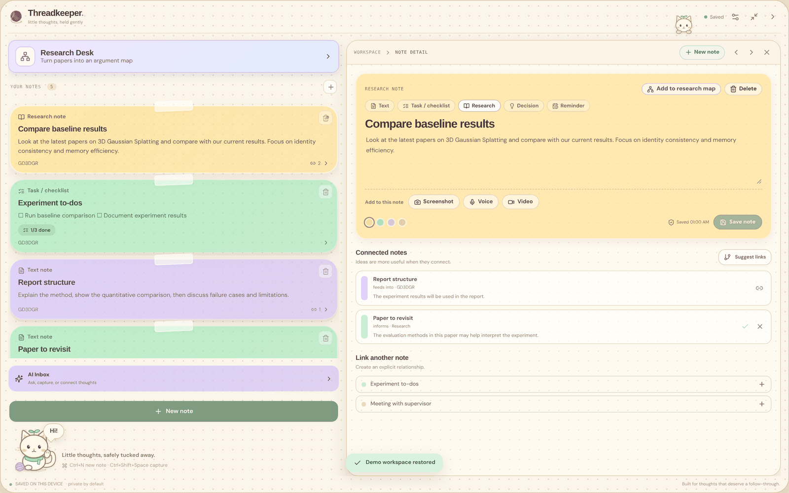 | 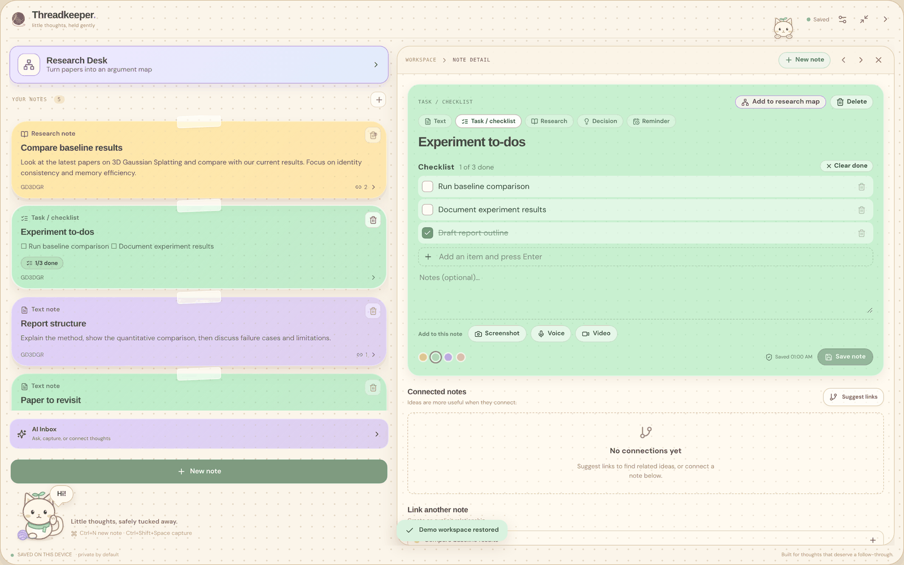 |

| Reminder note | New-note picker |
|---|---|
| 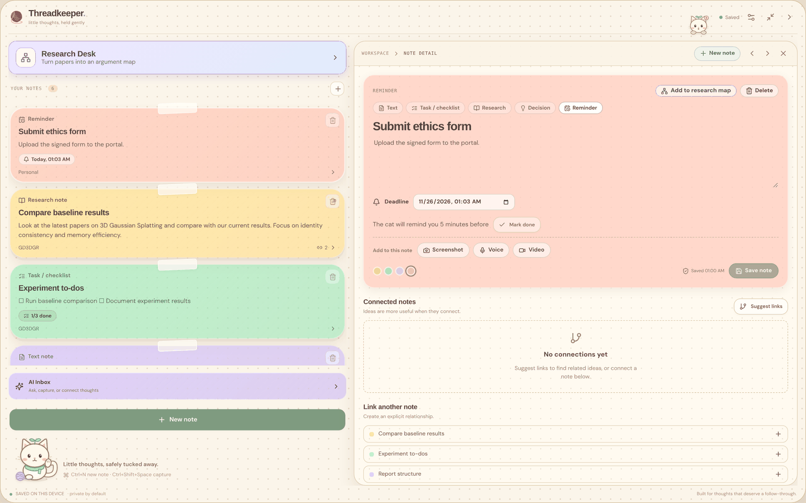 | 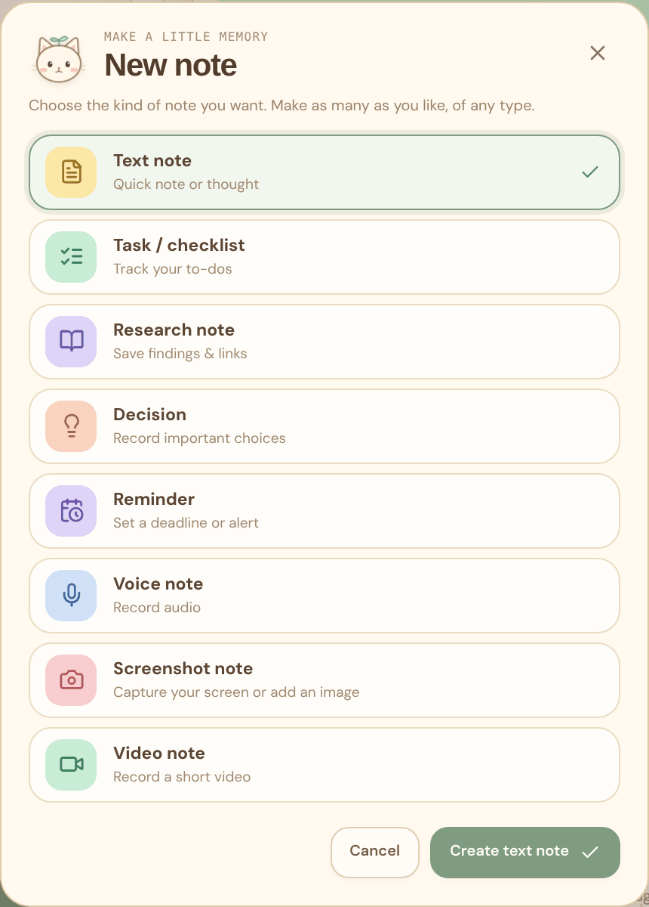 |

| Thread review (Thread Shift) | Rings map, zoomed |
|---|---|
| 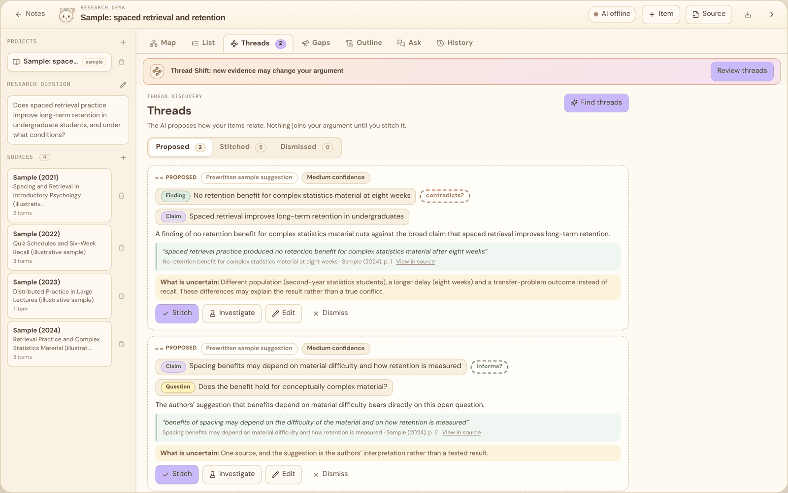 | 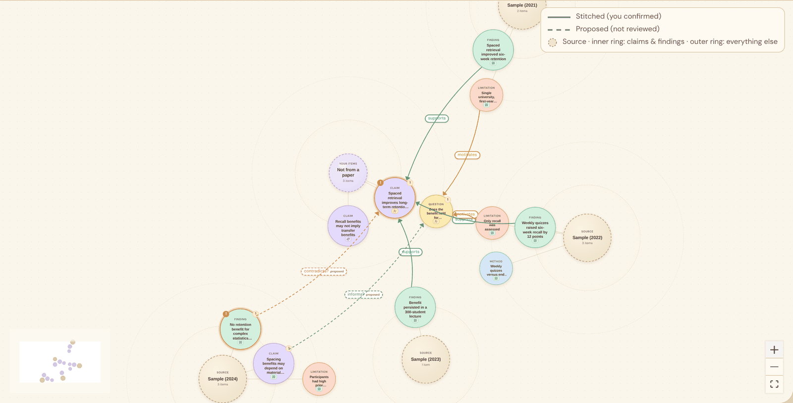 |

| Find papers (mock records) | Source viewer |
|---|---|
| 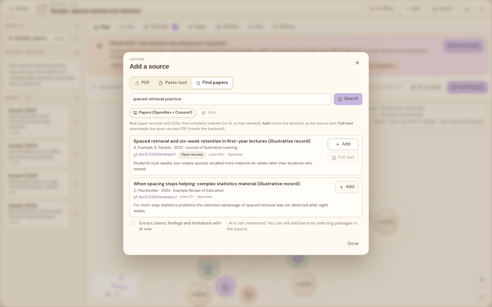 | 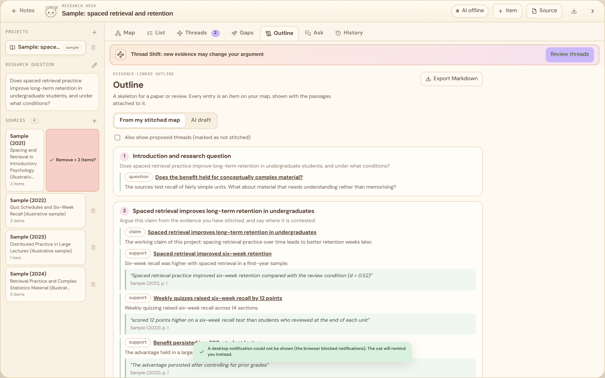 |

| List view | Outline |
|---|---|
| 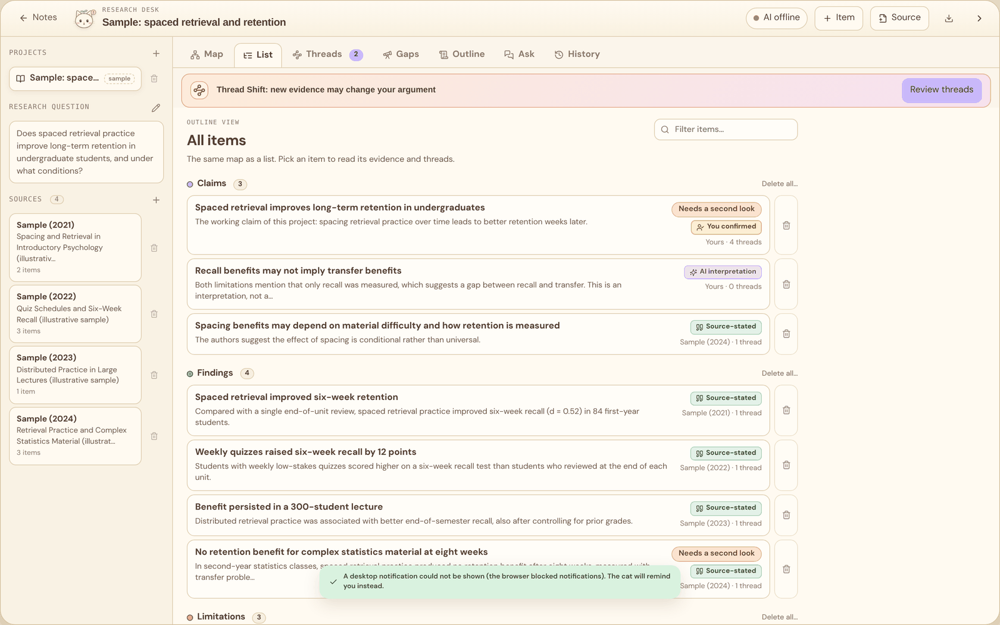 | 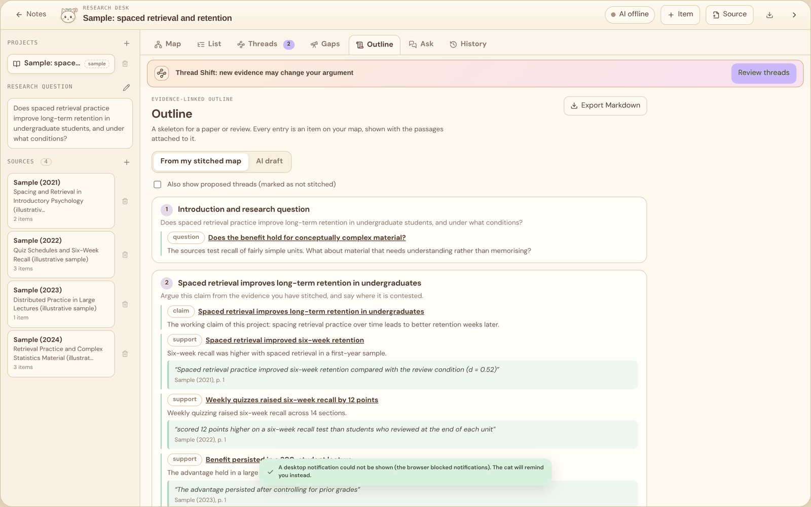 |

## How a research project flows

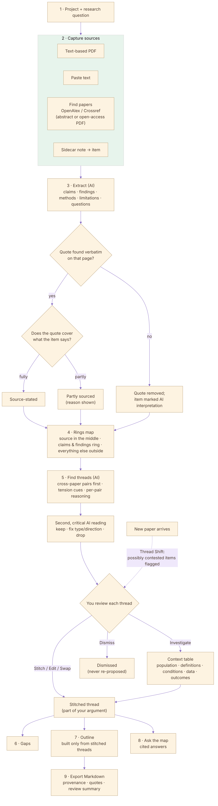

<details>
<summary>Mermaid source</summary>

See [docs/diagrams/workflow.mmd](docs/diagrams/workflow.mmd). GitHub renders the same diagram below.

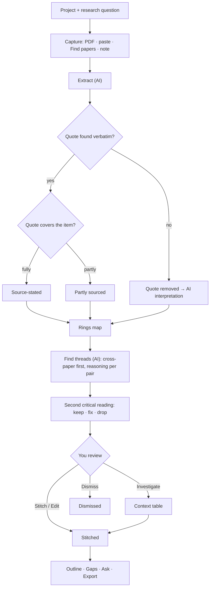
</details>

**Reminders**

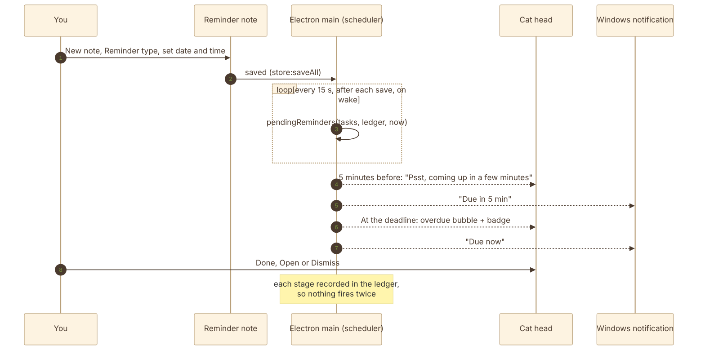

## Architecture

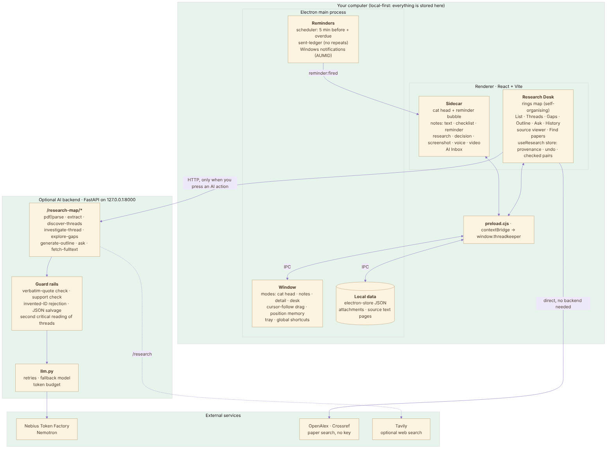

- **Electron main** owns the window (cat head, notes, detail, desk), cursor-follow dragging, the tray, local storage, and the **reminder scheduler**, so reminders fire whatever the window is doing.
- **Renderer** (React + Vite) holds the Sidecar and the Research Desk. All research state changes go through pure functions in `src/research/store.js`; the map layout is a deterministic simulation in `src/research/layout.js`.
- **Optional backend** (FastAPI) is called only when you press an AI action. Every model reply is validated: quotes must exist verbatim in the source, IDs must exist on the map, cut-off JSON is salvaged, and transient errors are retried with a fallback model.

Details, data model and design decisions: **[docs/ARCHITECTURE.md](docs/ARCHITECTURE.md)**.

## Run it

Requirements: Node.js 22, Python 3.11+ (only for the AI backend), Windows 10/11 (macOS/Linux work for development).

```bash
# 1. the desktop app
npm install
npm run dev            # Vite + Electron; the cat head appears on the right edge

# 2. optional: the AI backend (second terminal)
cd backend
python -m venv .venv
.venv\Scripts\activate          # macOS/Linux: source .venv/bin/activate
pip install -r requirements.txt
copy .env.example .env          # set NEBIUS_API_KEY and NEBIUS_MODEL (your Nemotron model ID)
uvicorn main:app --host 127.0.0.1 --port 8000
```

Try it with no AI and no PDFs: open the Research Desk → **Explore the sample project** → **Add the new paper**.

Windows installer: `npm run dist:win` (output in `release/`), or run the **Windows installer** workflow from the Actions tab.

## Tests and CI

```bash
npm test                                  # 39 tests: research store, links, rings layout, reminders, deadlines, migration
cd backend && pip install -r requirements.txt -r requirements-dev.txt && python -m pytest   # 33 tests
```

GitHub Actions:

- **[CI](.github/workflows/ci.yml)** on every push and pull request: app tests + Vite build, backend tests.
- **[Windows installer](.github/workflows/release.yml)** on demand or on a `v*` tag: builds the NSIS installer and attaches it to the release (unsigned).

## Results so far

See **[RESULTS.md](RESULTS.md)**. In short: a pilot on 3 real review papers with Nemotron found the quote guard-rail working (45 of 48 extracted items carried a quote found verbatim in the PDF text), and exposed duplicates, fragment quotes and mostly same-paper thread proposals. Those findings drove the extraction and thread changes in this version; the improved version has not been re-measured yet.

## Limitations

- Automated tests use a fake model: they verify validation and plumbing, not AI quality.
- Text-based PDFs only (no OCR). The map suits tens of items, not thousands.
- Local JSON storage (electron-store + per-source files), not SQLite. JavaScript, not TypeScript.
- Windows behaviour (toasts, dragging on scaled displays) was developed for Windows but tested by automation on Linux; check it on your machine.
- The installer is unsigned, so Windows SmartScreen will warn.

## Repository layout

```text
threadkeeper/
├── electron/            main process, preload bridge, reminder logic (reminders.cjs)
├── src/
│   ├── components/      cat head, reminder bubble, checklist editor, note picker, capture
│   ├── hooks/           window dragging
│   ├── lib/             note types, deadlines, notes data migration
│   └── research/        store, rings layout, paper search, outline, export, tests
│       └── desk/        Research Desk UI (map, list, threads, gaps, outline, ask, source viewer)
├── backend/             optional FastAPI service (extraction, threads, PDF, full text) + tests
├── docs/
│   ├── images/          screenshots and rendered diagrams
│   ├── diagrams/        Mermaid sources (architecture, workflow, reminders)
│   ├── ARCHITECTURE.md
│   └── USER_GUIDE.md
├── .github/workflows/   CI and Windows installer
├── RESULTS.md
└── LICENSE              MIT
```
