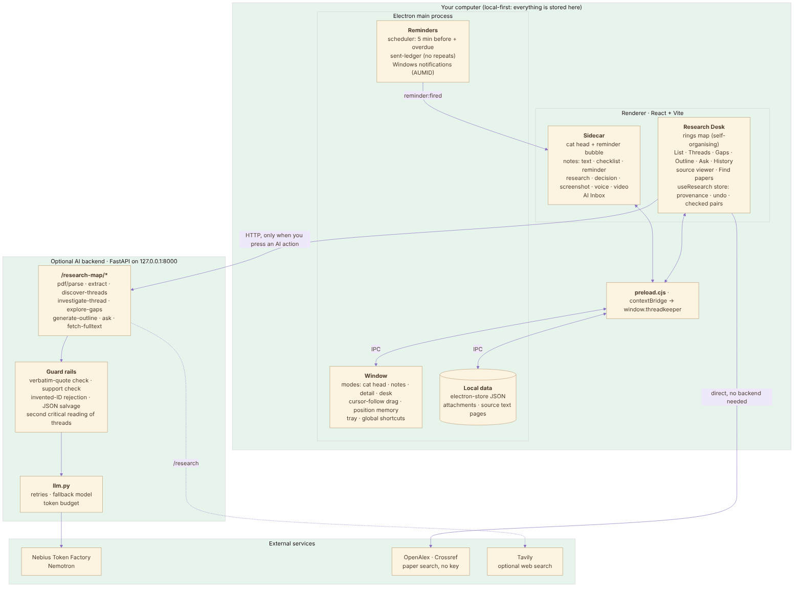
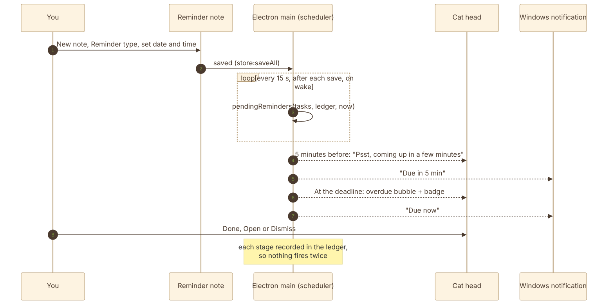

# Architecture

Source: [diagrams/architecture.mmd](diagrams/architecture.mmd) (Mermaid; re-render with `npx @mermaid-js/mermaid-cli -i docs/diagrams/architecture.mmd -o docs/images/architecture.png`).

## Processes

| Process | Code | Responsibility |
|---|---|---|
| Electron main | `electron/main.cjs` | Window modes (cat head, notes, detail, desk) and their sizes; cursor-follow dragging; tray and global shortcuts; local storage (`electron-store`) and per-file storage for attachments and source text; **reminder scheduling**; desktop notifications; opening links in the browser. |
| Preload | `electron/preload.cjs` | The only bridge: `window.threadkeeper` (save/load, window modes, drag, notifications, files). Context isolation on, no Node in the page, sandboxed. |
| Renderer | `src/` (React + Vite) | Sidecar UI, Research Desk UI, all state transitions. Runs in a browser too ("web preview", data in `localStorage`), which is how the UI tests run. |
| Backend (optional) | `backend/` (FastAPI) | PDF reading, AI extraction, thread discovery, investigation, gaps, outline, Q&A, open-access full text. Called only when the user presses an AI action. |

## Data model

Everything lives in one local store with these slices:

| Slice | Shape | Notes |
|---|---|---|
| `notes[]` | `{ id, title, body, noteType, items[], reminderAt, attachments[], color, … }` | `noteType` ∈ text, checklist, research, decision, reminder, image, voice, video. **Checklist items** are `items[] = { id, text, done }` on the note: no dates. |
| `tasks[]` | `{ id, title, dueAt, remindAt, completed, noteId, researchItemId? }` | Only **deadlines**: one per Reminder note (`rem-<noteId>`, kept in sync) plus dated Research Desk task items. The scheduler reads these. |
| `reminderLog` | `{ "<taskId>|<time>|soon|due": sentAt }` | Main-process ledger of what was announced. The page never writes it, so a save can never cause a repeat. |
| `research` | `projects, documents, items, evidence, connections, feedback, layouts, history, gaps, outlines, checkedPairs` | Pure transitions in `src/research/store.js`. Source text pages are stored as separate files, not in the store. |
| `settings` | `{ reminders, catBubble, aiBaseUrl, modelVersion, … }` | `modelVersion: 2` marks the checklist/deadline split; `src/lib/notesModel.js` migrates older data once (old dated tasks become Reminder notes, the rest become checklist items). |

## Key flows

### Reminders

`electron/reminders.cjs` (pure, unit-tested) decides what is due: a heads-up **5 minutes before**, then **due / overdue**; anything missed by more than 3 days is recorded silently. The main process checks every 15 s, shortly after every save, and on wake. Each fired reminder goes to the desktop (Windows needs a Start-menu shortcut with the app's AUMID; the dev build creates one) **and** to the page (`reminder:fired`), which pops the cat's bubble or shows a banner, so nothing is lost if Windows hides the toast.

### Dragging the cat

The page reports where inside the window the pointer went down; the main process polls the real cursor every 8 ms and places the window so that point stays under it (absolute, so it can never drift or snap back). A lost pointer capture no longer ends the drag; only releasing the button does.

### Extraction guard rails (`backend/research/service.py`)

1. The model must return JSON items with page-anchored quotes.
2. Each quote must be found **verbatim** (normalised whitespace/quotes) on a page of the stored text; otherwise it is removed. Fragments (cut-off sentences, headings) are rejected.
3. `support_check` compares the item with its quotes: numbers, names/acronyms, formulas and hedging must appear in the quote and most key words must be covered (spelled-out acronyms are recognised). Otherwise the item is **Partly sourced** with the reason.
4. Citation markers (`(12)`, `(Smith, 2020)`, "et al.") mark the item **Cites other work**.
5. Duplicates are dropped within a run, across parallel chunks, and against items already on the map.

### Thread discovery

1. **Candidates** (TF-IDF): near-duplicate pairs are skipped; at least three quarters of the pairs are between different papers when available; tension cues (competing percentages, contrast words, limitation vs result) raise priority. Pairs already checked and found unrelated are skipped until either item changes.
2. **Reasoning pass** (6 pairs per call): for each pair the model states what A and B say, picks the most precise relationship (contradicts, qualifies, supports, extends, explains, motivates, depends on, informs, related to, or none) and a direction (`A->B`), with quotes.
3. **Validation:** unknown pairs/IDs dropped, quotes checked against item text, prompt labels ("Item A", "P2") replaced by titles.
4. **Second, critical reading:** the reasoning model keeps, fixes (type, direction, wording) or drops each shortlisted proposal.
5. **Ranking:** relationship type, confidence, evidence, cross-paper bonus.

Model calls retry transient errors (429/5xx/timeouts) with back-off, salvage complete entries from cut-off JSON, give an empty "still thinking" reply more tokens once, and fall back from the reasoning model to the main model.

### Rings map layout (`src/research/layout.js`)

A deterministic simulation. Each source is a cluster centre; claims/findings live on an inner ring and other items on an outer ring, and **only their angle moves**. Threads rotate linked items towards each other; clusters joined by threads attract, unrelated clusters keep extra space, and cluster overlap is resolved hard. Dragged items keep their angle (they snap back onto their ring); dragged sources move their whole cluster. The renderer animates between layouts.

### Paper search (`src/research/scholar.js`)

OpenAlex first, Crossref as fallback, directly from the app (no backend, no key). DOIs, doi.org/publisher/arXiv links are looked up exactly. Records are normalised (abstract rebuilt from OpenAlex's inverted index, safe http(s) links only), merged by DOI and title, and marked if already in the project. "Full text" asks the backend to download an open-access PDF (public hosts only, re-checked after every redirect, 25 MB cap, must start with `%PDF`).

## Security

- Renderer: context isolation, no Node integration, sandbox; links open in the system browser and only for http(s).
- API keys live only in `backend/.env` (git-ignored). The backend binds to 127.0.0.1 and has no authentication: do not expose it publicly.
- Source text and web results are treated as untrusted: prompts wrap them in tags and instruct the model to ignore instructions inside.
- The full-text downloader refuses loopback, private, link-local and reserved addresses.

## Testing

| Suite | What it covers |
|---|---|
| `npm test` (node:test) | research store transitions, outline, export, paper-search normalisation and fallbacks, duplicate detection, checked pairs, rings layout (no overlaps, ring order, determinism, threads pull clusters), reminder schedule, deadline buckets, data migration |
| `pytest` (backend) | quote verification, provenance, fragment rejection, support check, duplicates, candidate pairs, reasoning-reply parsing, self-check fixes/drops, retries, JSON salvage, model fallback, PDF parsing, full-text fetch guards |

Both run in [CI](../.github/workflows/ci.yml). AI quality is not covered by tests; see [RESULTS.md](../RESULTS.md).
